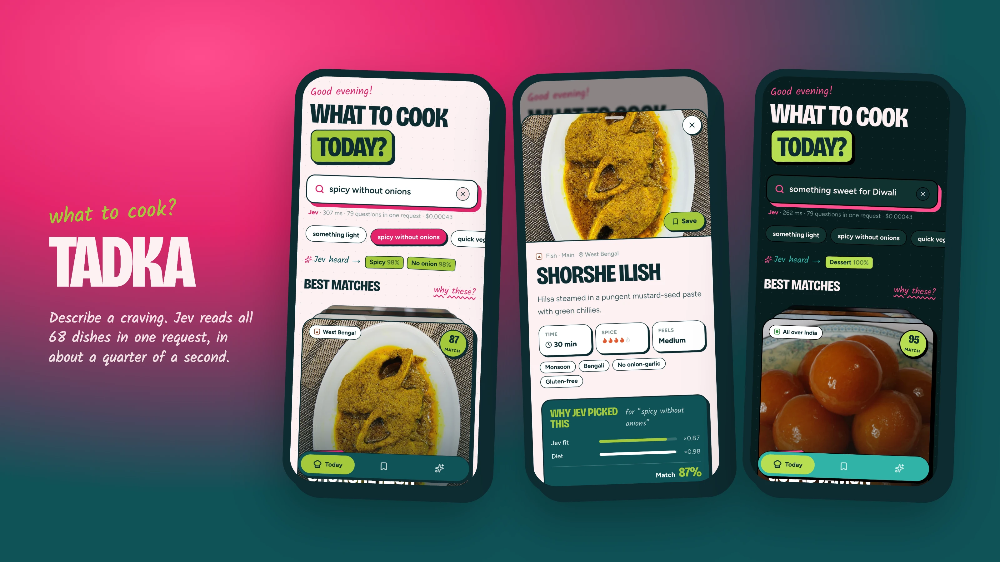
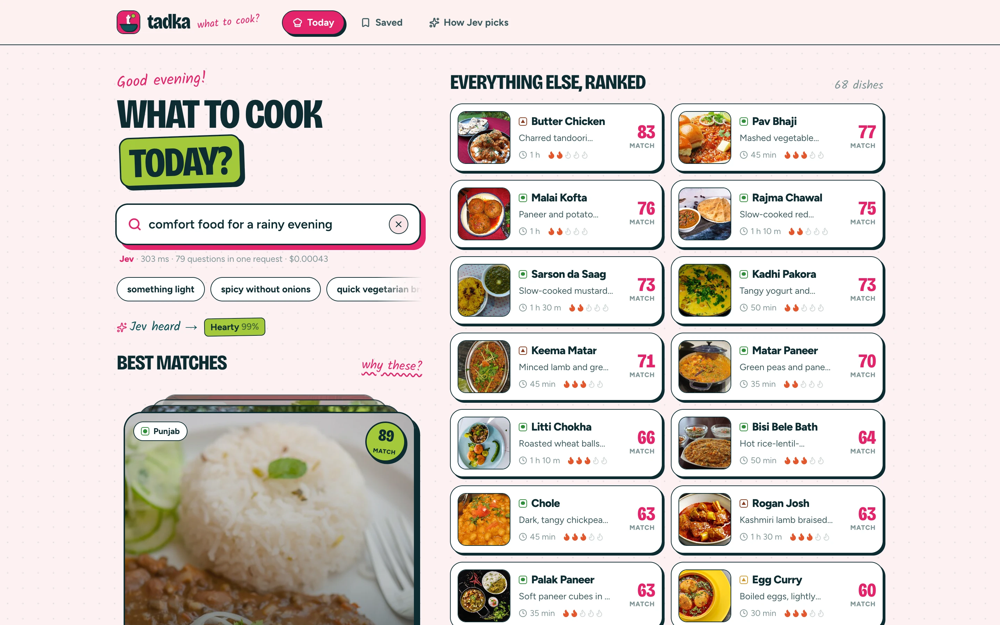
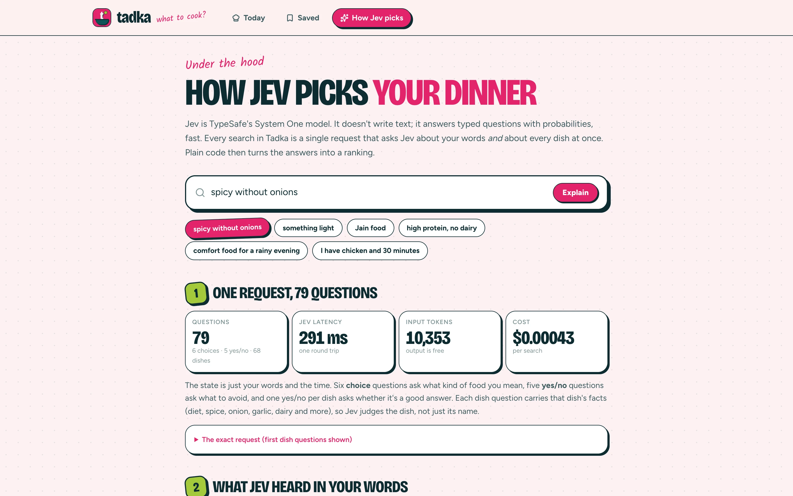
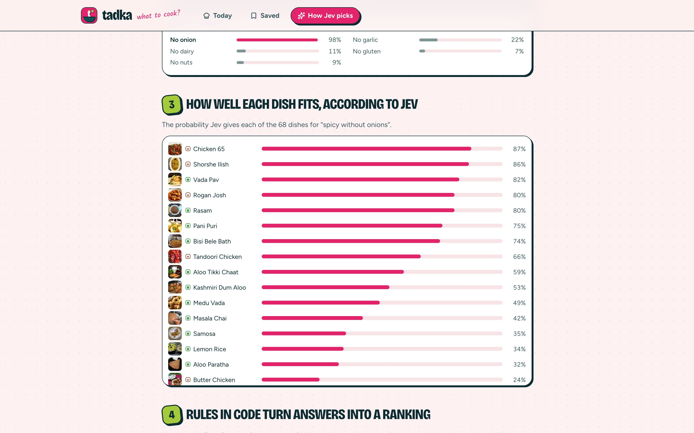

<!-- hero -->
<div align="center">

# Tadka

**What to cook today?**

What to cook today? An installable mobile app for Indian home cooking. Describe a craving and Jev scores all 68 dishes in one request.

     -7c3aed)



<sub>Search, dish details and dark mode on a phone</sub>

</div>

## Screenshots

| | |
|---|---|
|  |  |
| <sub>Desktop: 3D deck of top picks and the full ranking</sub> | <sub>How Jev picks: one request, 79 questions</sub> |
|  | |
| <sub>Every dish's fit probability, sorted</sub> | |

## About

An installable, mobile-first web app (PWA) for deciding what to cook. Describe what you feel like eating
("something light", "spicy without onions", "Jain food", "high protein, no dairy") and, half a second after you
stop typing, **Jev** scores all 68 classic Indian dishes against your words. The cards re-stack in 3D as the
ranking changes.

## How Jev is used

Every search is **one request with 79 typed questions** (`src/lib/intent.ts`, `src/app/api/match/route.ts`):

| Questions | Type | Asks |
|---|---|---|
| 6 | `choice` | Diet, spice, meal, light or hearty, time, region |
| 5 | `noul` (yes/no) | Avoid onion, garlic, dairy, gluten, nuts? |
| 68 | `noul` | One per dish: "Is this a good answer to the request?" Each carries the dish's facts |

Ranking happens in plain code (`src/lib/rank.ts`): **match = Jev fit × diet × preferences × avoid**. Diet and
ingredients to avoid are near-hard rules that switch on once Jev is fairly sure; preferences only nudge. All
factors are weighted by Jev's probabilities.

Measured: ~130–400 ms per search, ~10,400 input tokens, **about $0.00044 per search**. Identical searches are
served from a server-side cache.

The **How Jev picks** tab (`/how`) walks through a real request step by step: the exact JSON, every intent
probability, all 68 dish fits, the rules applied to the top dishes, how far each dish moved, and a speed and cost
comparison with an LLM (the LLM figure is an estimate; the assumptions are stated on the page).

## Features

- 68 dishes from every region, each with a real photo (Wikimedia Commons, credited per photo and on `/credits`),
  a one-line description, tags, diet mark, spice level, time, allergens, ingredients and method.
- Search as you type with a 500 ms debounce; newer keystrokes cancel older requests.
- "Jev heard" chips show what Jev understood, with confidence.
- 3D card deck for the top picks (swipe to go through them) and a ranked list that re-stacks on every search.
- Dish sheet with a "Why Jev picked this" breakdown. Save dishes to a cookbook stored on the device.
- Empty search shows time-of-day picks (breakfast, lunch, tea-time, dinner, late night) that change daily.
- **PWA:** manifest with regular and maskable icons, plus a service worker that caches the app and every photo
  you've seen. Offline, search falls back to a keyword matcher, clearly labelled.
- Design, "masala dabba pop": rani pink, peacock and pistachio on rose-tinted paper (peacock-night in dark mode);
  Bricolage Grotesque for headlines, Figtree for text and Kalam, a handwriting face from the Indian Type Foundry, for
  kitchen-note annotations; sticker cards with ink outlines and hard shadows; a floating pill tab bar on phones.

## Run it

```bash
npm install
npm run dev -- -p 3106
```

Put your key in `.env.local` as `TYPESAFE_API_KEY=…` (server-only). The service worker registers only in
production builds: `npx next build && npx next start -p 3106`. To install it on a phone, the app has to be served
over HTTPS (or localhost).

## Code map

- `src/lib/dishes.ts`: the 68 dishes · `src/lib/images.ts`: photos and credits
- `src/lib/intent.ts`: the questions · `src/app/api/match/route.ts`: the Jev call
- `src/lib/rank.ts`: ranking rules · `src/lib/offline.ts`: today's picks and the offline matcher
- `src/components/Kitchen.tsx`: home · `Deck.tsx`: 3D stack · `ResultList.tsx` · `DishSheet.tsx`
- `src/app/how/HowClient.tsx`: the walkthrough · `public/sw.js`: offline support
